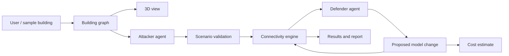

# Architecture notes

ExitZero combines a building connectivity model, AI-generated scenarios and proposals, deterministic checks and an interactive frontend. The distinction between *suggesting* a change and *verifying* it matters most.

## Building model

A graph represents spaces and the connections between them. This allows the engine to ask which occupied areas are still connected to an exit when selected connections are removed.

## Attacker and defender

The attacker proposes failure scenarios. The defender proposes changes that could improve the model. Both depend on structured inputs and outputs that need validating. A generated explanation alone should never be mistaken for the simulation result.

## Deterministic checks

The graph engine evaluates the proposed changes using explicit model rules. This provides a repeatable way to compare layouts and test whether previous failures have been addressed.

## Interface

The dashboard and 3D scene make it possible to inspect the layout, run tests and review outputs. The repository also contains the separate hackathon workstream folders that fed into the integrated application under `src/`.

## Limitations

The model addresses route connectivity, not comprehensive evacuation safety. It doesn't fully account for smoke, crowd flow, panic, physical building regulations or the needs of every individual. Cost outputs are indicative.
