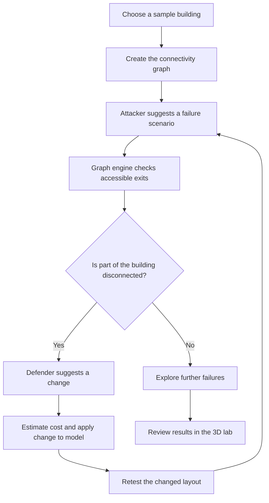

# ExitZero

**Testing what happens when evacuation routes fail.**

**Innovation Prize — Google DeepMind × Imperial Hackathon 2026**  
Team project · TypeScript · Next.js · Gemini · Graph simulation · 3D visualisation

ExitZero is a prototype for exploring weaknesses in building evacuation layouts. Instead of looking for one route that works in normal conditions, it looks for the connections a building depends on — then tests what happens when those connections are blocked.

We built it during the Google DeepMind × Imperial Hackathon, where our team won the **Innovation Prize**. The project brings together an AI attacker, an AI defender, a graph-based simulation and an interactive 3D view.

> **Note:** This is a hackathon prototype, not certified evacuation-planning software. Results are only meaningful within the assumptions of the model.

## The idea

Imagine a building with two exits, but both routes pass through the same corridor. On a floor plan it might look like there are two alternatives. Block that corridor, though, and neither works.

ExitZero is designed to find problems like that. It models rooms, junctions and exits as a graph, with doors, stairs and corridors forming connections between them. Blocking a connection changes which areas can still reach an exit.

The point is to test proposed fixes rather than just accepting them because they sound reasonable.

## How it works



There are three important parts:

- **Attacker:** uses Gemini to suggest difficult scenarios, such as a blocked staircase, doorway or route.
- **Defender:** suggests possible changes to the layout that could address a discovered weakness.
- **Simulation engine:** checks connectivity and retests suggested changes. A model's recommendation is not treated as proof that a route is safe.

The application also includes indicative cost modelling and a 3D building view so the effect of a failure is easier to understand.

## Trying the project

The repository includes sample building models. A straightforward way to explore the application is:

1. Start the app locally using the instructions below.
2. Open the clinic example at `/lab?b=clinic`.
3. Inspect the initial layout and connections.
4. Try a blocked route and look at how it affects reachability.
5. Run the attacker–defender loop and review the proposed changes and simulation output.

You can also try `/lab?b=industrial` for a different layout. The README's demo steps are intended as an exploration guide, not a claim that every scenario will produce a particular result.

For a more detailed walkthrough, see [docs/DEMO.md](docs/DEMO.md).

## Technology

| Area | Tools / approach |
| --- | --- |
| Application | TypeScript, Next.js, React |
| AI agents | Google Gemini, with fallback behaviour for local exploration |
| Simulation | Graph connectivity and failure testing |
| Visualisation | Three.js / React Three Fiber |
| Testing | Repository test tooling, including Vitest |

### Repository layout

| Path | What it contains |
| --- | --- |
| `src/` | Integrated application code |
| `src/engine/` | Graph simulation and verification logic |
| `src/agents/` | AI agent interactions |
| `src/scene/` | 3D scene and building representation |
| `src/dashboard/` | Interactive lab interface and reporting |
| `simulation-mathematics/` | Original simulation workstream |
| `gemini-agents/` | Original agent workstream |
| `visualisation-3d/` | Original 3D workstream |
| `dashboard-integration/` | Original integration workstream |
| `INTEGRATION.md` | Original team integration notes |

See [docs/ARCHITECTURE.md](docs/ARCHITECTURE.md) for a more detailed breakdown of the design.

## Run locally

You'll need Node.js and npm installed.

```bash
git clone https://github.com/FinnDymond/GeminixImperial_Halloween_Hackathon.git
cd GeminixImperial_Halloween_Hackathon
npm install
cp .env.example .env.local
npm run dev
```

Open [http://localhost:3000](http://localhost:3000).

To use Gemini-backed functionality, put your own `GEMINI_API_KEY` in `.env.local` as described in `.env.example`. **Never commit your API key.** Some features can be explored using fallback agents without a key.

For available scripts and tests, check `package.json`. Common project checks include:

```bash
npm test
npm run build
```

These are instructions for running the project, not a statement that the latest build has been independently tested.

## What this does — and doesn't — test

ExitZero tests connectivity in a simplified building model. It's useful for studying dependencies between routes and how local changes affect the model.

It does **not** replace a fire engineer, accessibility assessment or evacuation plan. The simulation does not fully model smoke, crowd movement, human behaviour, regulations or every real-world failure mode. Cost figures are indicative, not quotations.

## Hackathon and credits

ExitZero was developed collaboratively for the Google DeepMind × Imperial Hackathon. The team received the **Innovation Prize**, with 58 teams taking part.

We split the work across simulation, AI agents, 3D visualisation and integration, then brought the pieces together into the application. Claude was used extensively as a development tool during the event. Git commit history doesn't capture every part of a hackathon team's work, including design, prompting, testing and integration decisions.

- **Original team repository:** [Anton-coding1/Google_Deepmind_Hackathon](https://github.com/Anton-coding1/Google_Deepmind_Hackathon)
- **This repository:** an independently hosted copy retaining the original commit history, used for documenting and continuing the project
- **Team credit:** original authorship and contributions are preserved in the Git history. Specific individual contributions should be described accurately rather than inferred from commit counts.

